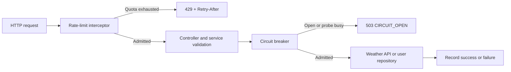

<!-- //Copyright ANuj Nautiyal -->
# Rate limiting and circuit breakers, explained with Spring Boot

This Java 17+ / Spring Boot 4 application demonstrates three thread-safe rate-limiter algorithms, independent circuit breakers, and a real weather HTTP integration. Small classes and comments explain the decisions. The existing `/users` endpoints are protected too.

You can run the examples and tests without PostgreSQL, Docker, a weather account, or real network calls to a weather provider. Live weather requests require an API key.

## 1. Quick start

Install a JDK (17 or newer), then open a terminal in the project directory:

```bash
java -version
./mvnw spring-boot:run
```

On Windows, use `mvnw.cmd spring-boot:run`. If you already have Maven installed, `mvn spring-boot:run` works too. The wrapper configuration is included; its first run downloads Maven and dependencies, so internet access is needed once. If the script has no execute permission, use `sh mvnw spring-boot:run`.

The service starts on `http://localhost:8080`. The default `demo` profile creates an empty H2 database in memory. Its data disappears when the application stops. Stop the service with Ctrl+C.

```bash
curl -i http://localhost:8080/demo/fixed
curl -i http://localhost:8080/users
```

`/users` initially returns `[]`. The application provides read endpoints, so insert sample users into PostgreSQL if you want persistent example data (see section 9).

## 2. What the two protections do

**Rate limiting** restricts how frequently requests may enter an endpoint. When a quota is exhausted, the request returns HTTP **429** immediately. It never waits for a token and never calls the database or weather API.

**Circuit breaking** remembers the outcome of dependency calls. Repeated failures open the circuit, making later requests return HTTP **503** immediately. A recovery probe is permitted after a cooldown.

The order matters:



Rate-limit denials do not affect circuit-breaker failure counts. Invalid weather input and a missing local API key are also excluded from those counts. Since rate limiting happens first, invalid requests still spend endpoint quota if admitted.

## 3. Endpoints and their default quotas

| Route | Purpose | Named policy | Algorithm | Default quota | Circuit |
| --- | --- | --- | --- | --- | --- |
| `GET /users` | List users | `users` | Fixed window | 20 per 10 seconds, shared with detail | `database` |
| `GET /users/{uuid}` | Look up a user | `users` | Fixed window | Same shared quota | `database` |
| `GET /weather?city=London` | Current weather | `weather` | Token bucket | Capacity 5, refill 5 per 10 seconds | `weather` |
| `GET /demo/fixed` | Compare fixed windows | `fixed-demo` | Fixed window | 3 per 10 seconds | None |
| `GET /demo/sliding` | Compare sliding windows | `sliding-demo` | Sliding window | 3 per 10 seconds | None |
| `GET /demo/token` | Compare token replenishment | `token-demo` | Token bucket | Capacity 3, refill 3 per 10 seconds | None |
| `GET /demo/circuit?fail=true` | Simulate dependency failure | `circuit-demo` | Fixed window | 100 per 10 seconds | `demo` |
| `GET /demo/circuit/state` | Inspect demo circuit | None | None | Unrestricted | Read state only |

The circuit demo routes exist **only in the `demo` profile**. Each named quota is **global across callers within one application process**, rather than per user, IP, city, or request header. Policies are independent; exhausting `fixed-demo` does not spend `sliding-demo` tokens. Both user controllers intentionally share `users`.

## 4. Try each limiter yourself

Run the application, then send four quick requests:

```bash
for i in 1 2 3 4; do
  curl -i http://localhost:8080/demo/fixed
  echo
done
```

The first three should return 200; the fourth should return 429 if all four arrive within the same window. Repeat with `/demo/sliding` and `/demo/token`. Restart the application for fresh quotas, or wait for capacity to return.

A rejection uses Problem Details JSON and includes an application error code:

```http
HTTP/1.1 429
Retry-After: 10
Content-Type: application/problem+json
```

```json
{
  "type": "about:blank",
  "title": "RATE_LIMITED",
  "status": 429,
  "detail": "Request quota exhausted for policy: fixed-demo",
  "instance": "/demo/fixed",
  "code": "RATE_LIMITED"
}
```

`Retry-After` is rounded up to whole seconds and is always at least 1. The actual value depends on the algorithm and elapsed time. It is a suggestion: another caller can spend the available capacity before you retry.

### Fixed window

A window keeps one accepted-request counter. At expiry, the next request resets the counter and starts a new window. Construction starts the initial window; no background timer is needed. This is cheap, but requests close to a boundary can produce a burst on each side.

### Sliding window

Keep timestamps of accepted requests. Remove timestamps that are at least one period old, then check the remaining count. This enforces the quota over the preceding period and avoids fixed-window boundary bursts. Rejected calls are not added. Memory is bounded by the configured capacity.

### Token bucket

Start with a full bucket. Refill continuously at `capacity / period`, retain fractional tokens, and spend one token per accepted request. Never accumulate beyond capacity. With the default demo quota, approximately one new token arrives every 3.33 seconds. This supports an initial burst while smoothing sustained traffic.

## 5. Try circuit opening and recovery

Start with a fresh application. Four failed simulated calls fill the default four-call observation window:

```bash
for i in 1 2 3 4; do
  curl -i 'http://localhost:8080/demo/circuit?fail=true'
  echo
done
curl -s http://localhost:8080/demo/circuit/state
curl -i http://localhost:8080/demo/circuit
```

The failures return `503` with code `DEPENDENCY_UNAVAILABLE`. State becomes `OPEN`; the next request returns `503` with code `CIRCUIT_OPEN`, without running the simulated dependency.

Wait more than five seconds, then request success:

```bash
sleep 6
curl -i http://localhost:8080/demo/circuit
curl -s http://localhost:8080/demo/circuit/state
```

The recovery probe succeeds and the circuit returns to `CLOSED`.

| State | Behavior |
| --- | --- |
| `CLOSED` | Admit calls; record completed outcomes in a count-based sliding window. |
| `OPEN` | Reject calls during the cooldown. |
| `HALF_OPEN` | Admit one recovery call; reject other callers while that probe runs. |

A successful probe closes the circuit; a failed probe opens it for another cooldown. Transition to half-open is lazy: an incoming call after cooldown triggers it. Merely reading `/demo/circuit/state` does not trigger recovery, so state can still show `OPEN` after five seconds.

Default settings require **at least four completed calls** and **at least 50% failures in the last four calls** to open. Four failures are an easy demonstration; four failures are not required if the minimum-call count has already been met. Weather, database, and demo outcomes are tracked separately.

The implementation uses the Resilience4j **core circuit-breaker module**, without Spring AOP annotations. An explicit `breakers.execute(name, supplier)` call makes the protected operation easy to see and avoids self-invocation surprises.

## 6. Weatherly / WeatherAPI integration

[Weatherly's quick start](https://weatherly.readthedocs.io/en/latest/quickstart.html) identifies Weatherly as a Python client using WeatherAPI.com. This Java application calls the underlying [WeatherAPI HTTP API](https://www.weatherapi.com/docs/) directly:

```text
GET https://api.weatherapi.com/v1/current.json?key=<API_KEY>&q=<CITY>&aqi=no
```

Create a WeatherAPI.com account and obtain an API key. Set it in the same terminal before starting the application:

```bash
export WEATHER_API_KEY='your-own-api-key'
./mvnw spring-boot:run
```

Windows PowerShell:

```powershell
$env:WEATHER_API_KEY = 'your-own-api-key'
.\mvnw.cmd spring-boot:run
```

Then call the local controller:

```bash
curl --get --data-urlencode 'city=New Delhi' http://localhost:8080/weather
```

The response shape is:

```json
{
  "city": "New Delhi",
  "country": "India",
  "temperatureCelsius": 28.5,
  "condition": "Sunny"
}
```

These numbers illustrate the format; a live response comes from the provider. The app does not fabricate weather when the provider fails. A city is trimmed, must be nonblank, and must contain at most 100 characters. Query values are URI-encoded, including spaces and reserved characters.

| Situation | Local response | Counted as provider failure? |
| --- | --- | --- |
| Missing `WEATHER_API_KEY` | 503 `WEATHER_NOT_CONFIGURED` | No |
| Blank/oversized city | 400 `INVALID_REQUEST` | No |
| Provider HTTP 400 with error code `1006` (unknown location) | 400 `INVALID_REQUEST` | No |
| Other provider errors, including other HTTP 400 codes | 503 `DEPENDENCY_UNAVAILABLE` | Yes |
| Network error, timeout, missing or malformed payload | 503 `DEPENDENCY_UNAVAILABLE` | Yes |
| Weather circuit open | 503 `CIRCUIT_OPEN` | No provider call |
| Weather quota exhausted | 429 `RATE_LIMITED` | No provider call |

The provider also uses HTTP 400 for invalid API URLs and internal errors, so status 400 alone is not enough to identify bad user input. Its documented error code is checked. Raw provider messages and exception URLs are discarded; application errors do not expose API keys.

The shared HTTP client has a **2-second connection timeout** and **3-second read timeout**, configurable in properties. `WEATHER_API_BASE_URL` overrides the base URL for compatible providers or local stubs; the request path and JSON format remain WeatherAPI-specific. Use HTTPS for real credentials. No provider account is needed to run the automated tests.

## 7. Configuration and extending the application

Settings live in `src/main/resources/application.properties`. To change an existing policy:

```properties
app.rate-limits.policies.weather.algorithm=SLIDING_WINDOW
app.rate-limits.policies.weather.capacity=10
app.rate-limits.policies.weather.period=30s
```

Supported algorithms are `FIXED_WINDOW`, `SLIDING_WINDOW`, and `TOKEN_BUCKET`. Capacity must be positive, and periods must be positive and at most one day. Invalid settings fail at startup. Restart after changing settings; the registries are constructed once.

A new named policy can use any algorithm:

```properties
app.rate-limits.policies.reports.algorithm=TOKEN_BUCKET
app.rate-limits.policies.reports.capacity=5
app.rate-limits.policies.reports.period=1m
```

Add `@RateLimiter("reports")` to a controller method. The annotation name must match a configured policy. Reusing a name shares its quota; use a new name for an independent quota. Unannotated handlers are unrestricted. The interceptor bypasses CORS `OPTIONS` preflight requests.

To implement another algorithm, add an `Algorithm` enum value, implement `RateLimitStrategy.tryAcquire()`, and add its constructor to `LimiterFactory`. Return `LimitDecision` rather than sleeping or throwing inside the algorithm. The HTTP layer handles rejection consistently.

Circuit settings are shared configuration, with independent instances:

```properties
app.circuit-breaker.window-size=4
app.circuit-breaker.minimum-calls=4
app.circuit-breaker.failure-threshold=50
app.circuit-breaker.open-duration=5s
```

A dependency call in a service uses `breakers.execute("weather", () -> client.current(city))`. To protect another dependency, add a fixed instance name in `Breakers`; do not derive names from arbitrary request input. Perform validation outside the protected call. `IllegalArgumentException` is ignored by the configured breaker because it denotes invalid input in this application; dependency failures must use another exception type.

## 8. Thread safety and project layout

Each limiter synchronizes **only the check/update of its own quota**. Without that lock, two threads could both observe the last free token and admit too many requests. Independent policies use independent objects and therefore independent locks. Time differences use `System.nanoTime()` so normal wall-clock adjustments do not change limiter refill rates.

The registry is an immutable map of fixed names. Strategy state is protected by its lock. Sliding-window history contains accepted timestamps only. The weather client, properties, and response DTOs are shared immutable/stateless objects; city and response values stay local to each call.

Resilience4j manages circuit state safely and permits one half-open probe. Its state-management lock is **not held while executing HTTP or repository calls**. Other requests can therefore be rejected promptly while a probe is slow. Repository methods manage their existing read-only transactions.

| Package | Responsibility |
| --- | --- |
| `annotations` | Existing `@RateLimiter` contract. |
| `limiting` | Algorithms, policies, admission result, registry, MVC interceptor. |
| `resilience` | Circuit configuration, fixed dependency instances, safe outage exception. |
| `weather` | Validated service, HTTP client, provider payloads, public weather response. |
| `service` | User dependency calls and local circuit simulation. |
| `controller` | Small HTTP routes delegating to services. |
| `config` | Property binding, interceptor registration, reusable HTTP client. |
| `api` | Centralized Problem Details responses. |
| `dto` | Existing user entity and Spring Data repository. |

This is an **in-memory, single-process** example. A restart resets quotas and circuits; multiple application instances each have their own quotas. A cluster-wide rate limiter would need shared storage such as Redis. A rate limiter regulates frequency; it is not a concurrency/bulkhead limit for in-flight calls. Those are useful next steps beyond this learning project.

## Optional local metrics, dashboards, tracing, and storage

Prometheus/Grafana metrics and OpenTelemetry traces are disabled by default. An opt-in
Docker Compose stack provides a dashboard, persistent trace storage in Tempo, and optional
local PostgreSQL. See [local setup and flags](ops/README.md) for independent feature flags,
startup commands, data retention, and PostgreSQL storage setup.

## 9. Optional PostgreSQL profile

The default demo requires no database installation. To use an existing PostgreSQL server, create the table in the selected database:

```sql
CREATE TABLE IF NOT EXISTS users (
    id UUID PRIMARY KEY,
    name VARCHAR(255) NOT NULL
);
INSERT INTO users (id, name)
VALUES ('00000000-0000-0000-0000-000000000001', 'Ada');
```

Configure the connection through environment variables:

```bash
export DB_URL='jdbc:postgresql://localhost:5432/postgres'
export DB_USERNAME='postgres'
export DB_PASSWORD='your-own-password'
./mvnw spring-boot:run -Dspring-boot.run.profiles=postgres
```

This profile validates the schema instead of changing it automatically, and disables the simulated circuit-failure routes. The repository still protects `/users` with the shared quota and database breaker. Existing PostgreSQL passwords are no longer hardcoded in source.

## 10. Run the tests and inspect coverage

Run all tests:

```bash
./mvnw test
```

Run the complete build, source-size checks, tests, executable packaging, coverage report, and the **80% minimum line-coverage gate**:

```bash
./mvnw clean verify
```

Windows: `mvnw.cmd clean verify`. Installed Maven: `mvn clean verify`.

The build fails if a Java method/constructor exceeds **10 code lines** (excluding blank/comment-only lines) or a Java file exceeds **100 total lines**. `checkstyle.xml` applies those limits to main and test source. New files carry the required copyright header. JaCoCo generates `target/site/jacoco/index.html`; open that file in your browser after `verify`. Individual test reports are in `target/surefire-reports`.

Run focused test groups:

```bash
./mvnw -Dtest=LimiterTests,AlgorithmBoundaryTests test
./mvnw -Dtest=BreakerTests test
./mvnw -Dtest=WeatherClientTests,WeatherProviderErrorTests,WeatherTransportTests,WeatherServiceTests test
./mvnw -Dtest=DemoHttpTests,WeatherHttpTests,WeatherErrorHttpTests,UserRateLimitHttpTests test
./mvnw -Dtest=UserServiceTests test
```

| Test group | What it verifies |
| --- | --- |
| Limiter tests | Quota exhaustion, exact boundaries, fractional refill, refill cap, independent policies, rejection behavior. |
| Concurrent limiter tests | 48 competing threads admit exactly the configured capacity for each algorithm. |
| Breaker tests | Failure threshold, blocked calls, cooldown, successful/failed recovery, independent dependencies. |
| Concurrent breaker test | One held recovery probe prevents 32 other competing requests from probing. |
| Weather client tests | Encoded request parameters, response mapping, provider error codes, incomplete payloads, sanitized errors. |
| Weather transport tests | Real HTTP requests to a local stub and actual configured read-timeout enforcement. |
| Weather service tests | Validation, missing key, provider-failure opening, no calls when open. |
| MVC integration tests | Actual annotations/interceptor wiring, HTTP 429/503, retry header, route behavior. |
| User tests | Shared quota across controllers, shared database breaker, repository calls skipped on rejection. |
| Context test | Application starts successfully with the embedded database. |

No test calls the real weather API or requires PostgreSQL. Limiter and breaker timing uses fake clocks, so cooldown tests do not rely on sleeps. The transport test deliberately stalls a local HTTP stub to verify the real network timeout. Concurrency tests release workers together and use bounded waits.

## 11. Troubleshooting

- **429 immediately:** other requests have spent this global policy's quota. Follow `Retry-After`, wait for refill, or restart the demo.
- **503 `WEATHER_NOT_CONFIGURED`:** set the key before launching the application, in the same terminal/process environment.
- **503 `DEPENDENCY_UNAVAILABLE`:** check API credentials, provider quota/status, URL, or database availability. Provider errors are intentionally not forwarded.
- **503 `CIRCUIT_OPEN`:** wait for the configured cooldown, then send a successful dependency call. Reading state alone does not close the circuit.
- **Port 8080 occupied:** use `./mvnw spring-boot:run -Dspring-boot.run.arguments=--server.port=8081` and update curl URLs.
- **Maven cannot download dependencies:** first-run builds need Maven Central access. Configure your organization's Maven mirror/proxy if required.
- **Maven cache is read-only:** use a writable cache, for example `mvn -Dmaven.repo.local=/tmp/rate-demo-maven clean verify`.
- **No coverage page after `test`:** the report is generated in the `verify` phase, not merely `test`.
- **PostgreSQL startup fails:** confirm the server, credentials, selected database, and `users` schema; the default demo profile avoids these requirements.

## 12. Use the same protections through MCP

The application also runs a Model Context Protocol (MCP) server at **`http://127.0.0.1:8080/mcp`**. MCP clients discover tools and invoke them over the supported **stateless Streamable HTTP** transport. This is a real MCP endpoint, with protocol negotiation and tool schemas, rather than a collection of REST endpoints renamed as tools.

Start it with the same command:

```bash
./mvnw spring-boot:run
```

No AI model subscription or model-provider key is required to run the MCP server. `get_weather` still requires `WEATHER_API_KEY` for actual weather data.

### Available tools

| Tool | Arguments | Behavior |
| --- | --- | --- |
| `list_rate_limiters` | None | Read every configured policy's name, algorithm, capacity and period. Does not consume a permit. |
| `try_acquire_rate_limit` | `policy`: configured name | Attempt to consume one permit. Returns `allowed` and `retryAfterSeconds`; does not call a dependency. |
| `list_circuit_breakers` | None | Read all named circuit states without running a recovery probe. |
| `get_circuit_breaker` | `name`: `weather`, `database`, or `demo` | Inspect one circuit without changing its state. |
| `get_weather` | `city`: nonblank string | Use the shared weather quota, then the existing weather service and circuit. |
| `list_users` | None | Use the shared users quota, then the existing user repository and database circuit. |
| `test_circuit_breaker` | `fail`: boolean | **Demo profile only.** Simulate failure (`true`) or success (`false`) through the demo quota and circuit. |

**REST and MCP share the same objects and state.** For example, `try_acquire_rate_limit` with `policy="fixed-demo"` spends one of the three permits available to `GET /demo/fixed`. Likewise, opening the demo circuit from MCP makes REST demo calls fail fast. Do not call `try_acquire_rate_limit` before `get_weather` to preauthorize it: `get_weather` already acquires its own permit, so that would spend twice.

Stateless describes the **transport**, not the application quotas. Rate-limit and circuit state remain shared in memory across requests until the app restarts. Inspecting policies or circuits does not consume quota. MCP tool declarations mark inspection as read-only and permit-spending calls as non-idempotent.

The MCP endpoint uses functional routing, which does not run controller annotation enforcement. `McpToolRunner.guarded()` therefore explicitly checks the existing registry **before** invoking a service. The circuit remains in the service, preserving the same rate-limit-before-circuit order as REST.

### Connect a client

Use a native client that supports Streamable HTTP, with server URL `http://127.0.0.1:8080/mcp`. For clients whose configuration accepts an `mcpServers` map with a URL, the entry is:

```json
{
  "mcpServers": {
    "rate-limiting-demo": {
      "url": "http://127.0.0.1:8080/mcp"
    }
  }
}
```

Client configuration formats vary; select Streamable HTTP in clients that require an explicit transport choice. The MCP test suite uses the official Java SDK to verify initialization, discovery and invocation over a real HTTP connection.

To inspect the wire protocol using curl, initialize a connection:

```bash
curl -sS http://127.0.0.1:8080/mcp \
  -H 'Content-Type: application/json' \
  -H 'Accept: application/json, text/event-stream' \
  -d '{"jsonrpc":"2.0","id":1,"method":"initialize","params":{"protocolVersion":"2025-11-25","capabilities":{},"clientInfo":{"name":"curl-demo","version":"1.0"}}}'
```

Send the initialized notification, then discover tools. Use the protocol version returned by initialization for subsequent requests; these examples request `2025-11-25`:

```bash
curl -sS http://127.0.0.1:8080/mcp \
  -H 'Content-Type: application/json' \
  -H 'Accept: application/json, text/event-stream' \
  -H 'MCP-Protocol-Version: 2025-11-25' \
  -d '{"jsonrpc":"2.0","method":"notifications/initialized"}'

curl -sS http://127.0.0.1:8080/mcp \
  -H 'Content-Type: application/json' \
  -H 'Accept: application/json, text/event-stream' \
  -H 'MCP-Protocol-Version: 2025-11-25' \
  -d '{"jsonrpc":"2.0","id":2,"method":"tools/list","params":{}}'
```

Invoke the rate-limiter tool:

```bash
curl -sS http://127.0.0.1:8080/mcp \
  -H 'Content-Type: application/json' \
  -H 'Accept: application/json, text/event-stream' \
  -H 'MCP-Protocol-Version: 2025-11-25' \
  -d '{"jsonrpc":"2.0","id":3,"method":"tools/call","params":{"name":"try_acquire_rate_limit","arguments":{"policy":"token-demo"}}}'
```

The result includes both text content and structured JSON. Successful operations put their output under `structuredContent.data`. A denied explicit permit attempt is a successful tool result containing `allowed=false`; the caller can inspect its retry hint. A protected dependency call rejected by a quota instead returns `isError=true` with code `RATE_LIMITED` and a positive `retryAfterSeconds`.

Other safe error codes are `CIRCUIT_OPEN`, `WEATHER_NOT_CONFIGURED`, `INVALID_ARGUMENT`, and `DEPENDENCY_UNAVAILABLE`. Zero retry seconds on non-quota errors means no precise retry delay is supplied. MCP tool failures use MCP result semantics, typically HTTP 200 with `isError=true`, rather than the REST 429/503 status format. Raw SQL, provider URLs, credentials and exception messages are never passed through the tool adapter.

### Configuration, access and tests

MCP is configured in `application.properties`:

```properties
spring.ai.mcp.server.protocol=STATELESS
spring.ai.mcp.server.type=SYNC
spring.ai.mcp.server.streamable-http.mcp-endpoint=/mcp
```

Set `spring.ai.mcp.server.enabled=false` to disable the MCP transport. Spring AI 2.0.1 uses the `streamable-http.mcp-endpoint` property for its stateless transport too; this is verified by the custom-endpoint integration test. Changing the endpoint also changes the origin filter's protected path. The new `mcp` package contains adapters, safe result conversion, quota admission and the origin filter; existing algorithms and circuit state are reused.

The application now binds to **`127.0.0.1` by default**, keeping this unauthenticated teaching server local. The MCP path rejects requests carrying an `Origin` header; native clients and curl normally omit it. Browser-based connections are intentionally blocked. REST routes continue to use their existing behavior. If deploying remotely, provide authentication and an explicit origin policy before overriding `server.address`; the starter does not supply an authentication boundary automatically.

Run MCP tests independently:

```bash
./mvnw -Dtest=McpProtocolTests,McpCircuitProtocolTests,McpProductionProfileTests,McpToolUnitTests test
```

These tests exercise a real initialized SDK client, tool discovery and required input schemas, cross-interface shared quotas, concurrent admission, retry advice, safe errors, circuit opening, rejection of browser origins, a custom MCP endpoint, and hiding the failure-simulation tool outside the demo profile. The complete `./mvnw clean verify` build includes MCP tests and the same source-size and coverage checks.


## References

- [Weatherly quick start](https://weatherly.readthedocs.io/en/latest/quickstart.html): identifies the underlying provider.
- [WeatherAPI documentation](https://www.weatherapi.com/docs/): endpoint, parameters, payload and error codes.
- [Resilience4j circuit breaker](https://resilience4j.readme.io/docs/circuitbreaker): state machine and configuration.
- [JaCoCo Maven plugin](https://www.jacoco.org/jacoco/trunk/doc/maven.html): coverage reports and verification.
- [Spring AI MCP server](https://docs.spring.io/spring-ai/reference/api/mcp/mcp-stateless-server-boot-starter-docs.html): supported stateless HTTP transport.
- [MCP annotations](https://docs.spring.io/spring-ai/reference/api/mcp/mcp-annotations-server.html): tool discovery, schemas and hints.
